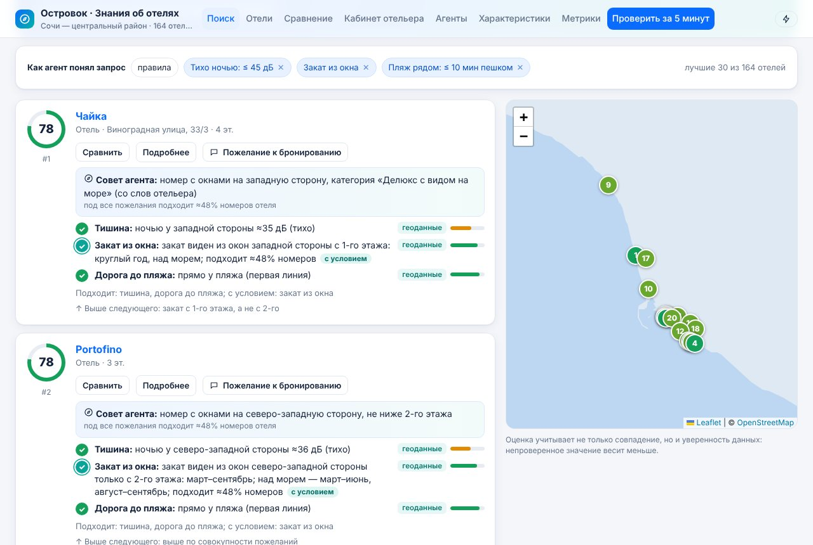
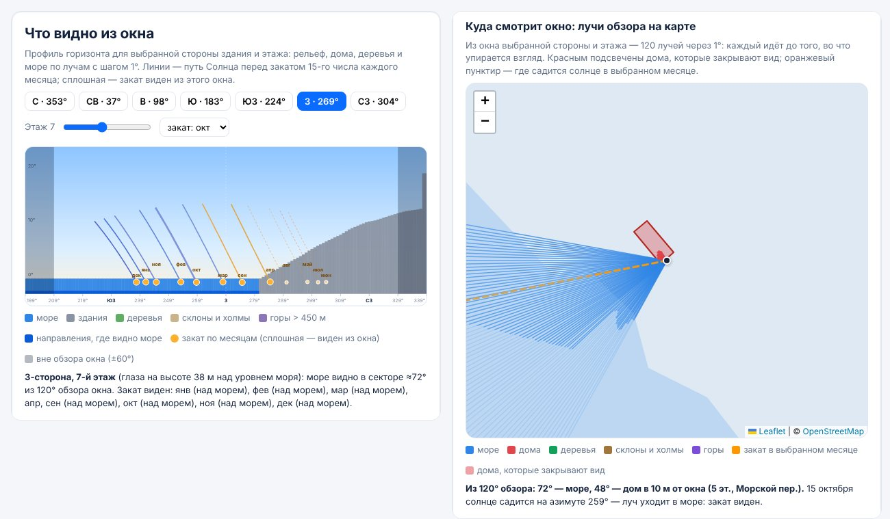
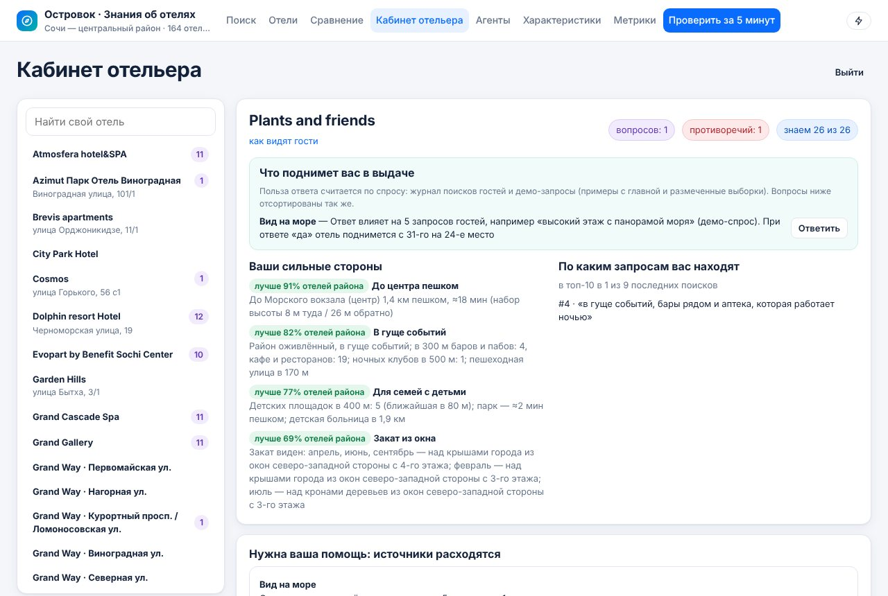
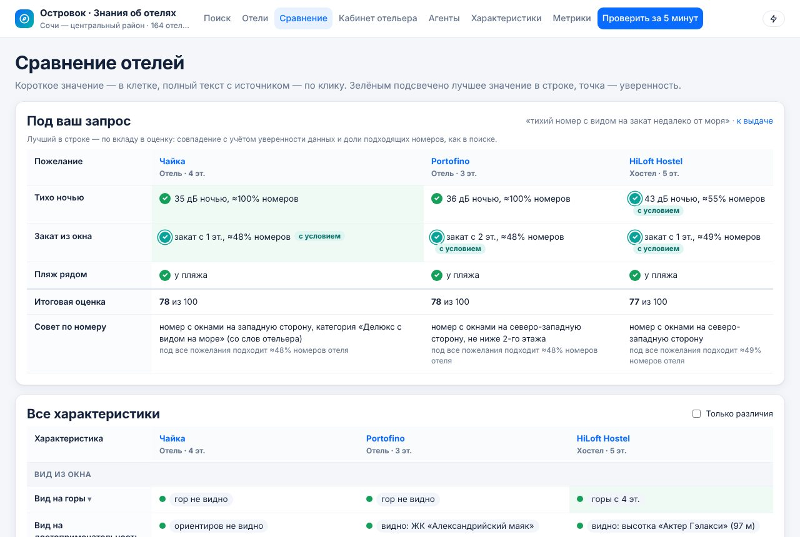
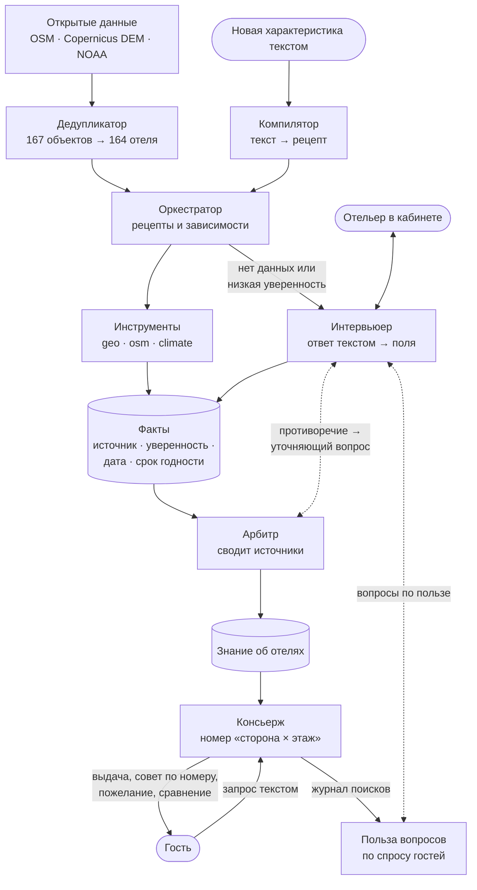

# Островок · Знания об отелях (трек «Данные»)

Агенты собирают об отелях то, чего нет в карточках: что видно из окна с каждой стороны здания и с каждого этажа, когда виден закат, насколько тихо ночью и сколько на самом деле идти до моря, — по открытым геоданным, а остальное спрашивают у отельера. Гость ищет отель запросом на естественном языке и получает совет, какой номер просить, а у каждого значения видны источник, уверенность и срок годности.

- **Видео-скринкаст:** _добавить ссылку перед сдачей_
- Развёрнутый сервис: нет (запускается локально одной командой)

<table>
<tr>
<td width="50%"><a href="docs/img/search.jpg"></a><br><sub><b>Выдача.</b> Пожелания со статусами ✓ / ✓ с условием, совет «какой номер просить», доля подходящих номеров и почему отель выше следующего.</sub></td>
<td width="50%"><a href="docs/img/view_rays.jpg"></a><br><sub><b>Что видно из окна.</b> Панорама на рекомендованной стороне и этаже и те же 120 лучей на карте: море, дом-заслон, закат месяца.</sub></td>
</tr>
<tr>
<td width="50%"><a href="docs/img/hotelier.jpg"></a><br><sub><b>Кабинет отельера.</b> «Что поднимет вас в выдаче» — вопросы по пользе для спроса гостей; ниже — противоречие источников с уточняющим вопросом.</sub></td>
<td width="50%"><a href="docs/img/compare.jpg"></a><br><sub><b>Сравнение под запрос.</b> Пожелания гостя со статусами у каждого отеля, итоговая оценка и совет по номеру; ниже — все характеристики.</sub></td>
</tr>
</table>

Регион — **центральный Сочи**: 164 отеля из OpenStreetMap (агент-дедупликатор склеил 3 дубля среди 167 объектов) и 44 тыс. зданий вокруг. Здесь есть всё, что можно считать по геоданным: море, закаты над ним, горы до 3 км, перепад высот и железная дорога вдоль пляжа.

## Что отличает решение

1. **Совет по номеру, а не только по отелю.** Вид, закат и тишина считаются для каждой стороны здания и каждого этажа, поэтому консьерж оценивает номера «сторона × этаж» и пишет, какой номер просить: «номер с окнами на западную сторону, не ниже 7-го этажа» — «под все пожелания подходит ≈42% номеров отеля». Если пожелание выполняется не во всех номерах, статус — «✓ с условием». На 19 парах «для запроса Q отель A должен стоять выше B», размеченных по фактам до настройки, порядок верен в 94,7% пар; прежний ранжировщик без доли номеров — 89,5%.
2. **Вид из окна считается лучами.** Из каждой стороны здания на каждом этаже идут 120 лучей через 1° по рельефу (Copernicus DEM, до 50 км), 44 тыс. зданий с высотами и деревьям, с кривизной Земли и рефракцией. Те же лучи нарисованы на карте: видно, какой дом закрывает море и на каком расстоянии. Положение Солнца сверено с PyEphem: ошибка не больше 1,2 мин по времени заката и 0,1° по азимуту.
3. **У каждого значения есть происхождение.** Факт хранит источник, уверенность, дату, срок годности и доказательства. Арбитр сводит источники и ловит противоречия: в демо их 46, по 35 агент сам задал отельеру уточняющий вопрос.
4. **Вопросы отельеру — по пользе.** Польза вопроса — на сколько позиций в топ-30 поднимется отель по запросам гостей, если ответ будет «да». Лучшие 20% вопросов дают 52% всей пользы, и в кабинете они первыми: «Что поднимет вас в выдаче».
5. **Работает без LLM.** Запросы гостей, ответы отельеров и описания новых характеристик разбираются правилами; модель, если её подключить, только переводит текст в структуры и ничего не угадывает. На отложенных выборках, которые не использовались для настройки, правила дают F1 0,873 на запросах и 84,8% на ответах отельеров.
6. **Справочник отелей чистится.** Агент-дедупликатор склеивает отель, нанесённый в OSM дважды (точкой и контуром), объединяет корпуса одного комплекса в одну карточку выдачи и подписывает тёзок по улице: «Grand Way · Северная ул.».

## Быстрый старт

```bash
git clone <URL репозитория>
cd <repo>
cp .env.example .env   # необязательно: без .env используются значения из .env.example
docker compose up --build
# открыть http://localhost:8080
```

Первый запуск занимает 3–8 минут на сборку образа (на Apple Silicon дольше из-за эмуляции `linux/amd64`). Сам старт после этого — около 10 секунд: приложение загружает заранее собранное агентами знание из `data/seed/seed.json.gz`, и все страницы сразу заполнены. В интерфейсе можно перезапустить агентов по любому отелю и увидеть их работу вживую.

Ключ LLM **не обязателен**. Без него запросы гостей, ответы отельеров и описания новых характеристик разбираются правилами. С ключом любого OpenAI-совместимого API их разбирает модель (см. переменные `LLM_*`).

## Что посмотреть за 5 минут

Откройте http://localhost:8080/tour — страницу «Проверить за 5 минут» (кнопка есть в шапке и на главной). Там девять шагов по требованиям задания; кнопка «Открыть» у каждого шага ведёт прямо в нужное состояние. Отели для показа подбираются по текущим данным: где этаж меняет вид, где расчёт и отельер расходятся и т. д. Кнопка внизу страницы возвращает демо в исходное состояние. Сценарий с текстом для показа — в [docs/DEMO.md](docs/DEMO.md).

| Шаг | Что увидеть | Требование |
|---|---|---|
| 1 | Выдача по запросу «тихий номер с видом на закат недалеко от моря»: пожелания со статусами, «✓ с условием», совет по номеру, пожелание к бронированию | основное 5, доп. 1 |
| 2 | Панорама из окна и лучи обзора на карте, ползунок этажа | основное 1 |
| 3 | «Вид на море»: факты расчёта и отельера, уверенность, срок годности | основное 3 |
| 4 | Живой прогон агентов с журналом решений | основное 1 |
| 5 | Кабинет отельера: ответ свободным текстом → поля, противоречие, «Что поднимет вас в выдаче» | основное 2 и 3, доп. 3 |
| 6 | Новая характеристика текстом → рецепт → значения у всех отелей | основное 4 |
| 7 | «Рядом построили дом»: лучи закрываются, лента «было → стало» | доп. 4 |
| 8 | Сравнение под запрос | доп. 2 |
| 9 | Метрики качества | доп. 5 |

## Зависимости и переменные окружения

Рекомендованные ресурсы:
- 2 CPU
- 2 ГБ RAM (приложение занимает около 0,5 ГБ, Postgres — около 50 МБ)
- около 1,5 ГБ на диске под образы

Сервисы в `docker-compose.yml`:
- `app` — FastAPI (Python 3.12) + собранный фронтенд (React), порт 8080. Образ многоэтапный, процесс работает не от root, есть healthcheck по `/health`.
- `db` — Postgres 16 (`postgres:16.4-alpine`) с healthcheck. `app` стартует после `service_healthy`.

Переменные окружения (все есть в `.env.example`):

| Переменная | По умолчанию | Назначение |
|---|---|---|
| `APP_PORT` | `8080` | порт приложения |
| `DATABASE_URL` | `postgresql+psycopg://app:app@db:5432/ostrovok` | БД. В compose собирается из `POSTGRES_*`; без Docker по умолчанию SQLite |
| `POSTGRES_USER` / `POSTGRES_PASSWORD` / `POSTGRES_DB` | `app` / `app` / `ostrovok` | учётные данные Postgres |
| `LLM_API_KEY` | пусто | ключ OpenAI-совместимого API; пусто — работают правила |
| `LLM_BASE_URL` | `https://api.openai.com/v1` | адрес API (можно YandexGPT-совместимый шлюз, vLLM, Ollama и т. п.) |
| `LLM_MODEL` | `gpt-4o-mini` | модель |
| `LLM_TIMEOUT` | `40` | таймаут запроса к LLM, с |
| `SEED_ON_START` | `true` | при пустой БД загрузить готовое знание агентов из `data/seed` |
| `WORKER_ENABLED` | `true` | фоновый воркер: очередь запусков агентов и актуализация |
| `ACTUALIZE_INTERVAL_MIN` | `30` | как часто агенты ищут и перепроверяют устаревшие данные |
| `HOTELIER_AUTOREPLY` | `false` | симулятор отельера сам отвечает на новые вопросы (демо) |
| `HOTELIER_LOGIN` / `HOTELIER_PASSWORD` | `hotelier` / `hotelier123` | демо-вход в кабинет отельера |
| `SECRET_KEY` | `change-me-in-env` | подпись токенов кабинета |
| `LOG_LEVEL` | `INFO` | уровень логов (stdout) |

## Сидирование

Ничего делать не нужно: при первом старте с пустой БД приложение само загружает отели региона и заранее собранное знание агентов. В нём 3 943 факта, 1 827 вопросов отельерам (1 121 с ответами от симулятора), 46 противоречий, 1 286 запусков агентов и 22 тыс. шагов в журнале.

Вернуть демо в исходное состояние после экспериментов — кнопка «Вернуть демо» внизу страницы `/tour` (или `POST /api/demo/reset`): удаляются ответы, добавленные характеристики и построенные дома, знание заново загружается из сида. Из командной строки:

```bash
docker compose exec app python -m app.reseed && docker compose restart app   # то же самое
docker compose down -v && docker compose up --build                          # полностью снести данные Postgres
```

Пересборка данных из сырых источников (необязательно, нужна сеть, ~40 мин) и повторный прогон агентов по всем отелям (~10 мин):

```bash
pip install -r backend/requirements-dev.txt osmium tifffile imagecodecs h5py   # + apt install osmium-tool
sh scripts/fetch_data.sh          # OSM, Copernicus DEM, NOAA → data/sochi
python scripts/precompute.py      # агенты по всем отелям → data/seed/seed.json.gz
```

## Маршруты/доступ

- `/` — поиск на естественном языке: «тихий номер с видом на закат недалеко от моря»
- `/tour` — демо-тур «Проверить за 5 минут» и сброс демо
- `/hotels` — все отели региона на карте
- `/hotel/<id>` — карточка: всё, что знают агенты, с источниками и уверенностью; панорама «что видно из окна» по сторонам и этажам и лучи обзора на карте; шум по фасадам; маршрут до пляжа с профилем высот; журнал агентов
- `/compare?ids=a,b,c&q=запрос` — сравнение: сначала пожелания запроса, затем все характеристики
- `/hotelier` — кабинет отельера: вопросы агентов по пользе, ответ свободным текстом, подтверждение и исправление значений, сильные стороны отеля. **Тестовый пользователь: `hotelier` / `hotelier123`**
- `/agents` — агенты и их инструменты, очередь запусков, противоречия на модерации, актуализация, сценарий «рядом построили дом»
- `/characteristics` — каталог характеристик и добавление новой текстовым описанием
- `/metrics` — метрики качества
- `/health` — `200 OK`, JSON `{"status": "ok"}`
- `/docs` — OpenAPI (Swagger) для всех методов API

## Как это работает



**Агенты** (`backend/app/agents`) делят работу по ролям:

| Агент | Что делает |
|---|---|
| Оркестратор | ведёт очередь запусков и порядок сбора с учётом зависимостей (этажность — раньше видов) |
| Геоаналитик | виды из окна, закат, горы, ориентиры, шум, пешие маршруты, транспорт |
| Исследователь OSM | инфраструктура вокруг, часы работы, стройки, история здания, теги отеля |
| Климатолог | море и погода по месяцам |
| Интервьюер | формулирует вопросы отельеру и раскладывает свободный ответ по полям |
| Арбитр | сводит источники, ловит противоречия, следит за сроком годности |
| Консьерж | понимает запрос гостя, подбирает сторону здания и этаж, объясняет выбор, пишет пожелание к бронированию |
| Компилятор | превращает текстовое описание новой характеристики в рецепт |
| Дедупликатор | склеивает отель, нанесённый в OSM дважды (точкой и контуром), связывает корпуса комплекса, подписывает тёзок по улице |

**Характеристика — это декларативный рецепт** (`backend/app/knowledge/specs/*.yaml`): поля значения, цепочка инструментов, когда спрашивать отельера (`missing`, `low_confidence`, `verify`, `always_once`), порог уверенности, срок годности, какие поля сверять между источниками, порядок авторитетности источников и фразы для поиска. Агент-сборщик идёт по рецепту и проверяет применимость каждого инструмента к конкретному отелю (есть ли контур здания, известна ли этажность). Он сохраняет факт и, если данных нет или уверенность ниже порога, передаёт задачу интервьюеру. Каждое решение пишется в журнал, который виден в интерфейсе.

**Достоверность.** У каждого факта есть `source`, `confidence`, `observed_at`, `valid_until` и `evidence`: из чего сложилась уверенность, какие данные использованы, ответ отельера. Арбитр:
- выбирает основной источник по авторитетности для конкретной характеристики. Для видов расчёт по геоданным важнее самоотчёта отельера, а про питомцев главный источник — отельер;
- повышает уверенность, если независимые источники согласны (noisy-OR);
- при расхождении по сравниваемым полям заводит противоречие, снижает уверенность и задаёт отельеру уточняющий вопрос со своей гипотезой: «По нашим данным (расчёт по геоданным): море видно из окон южной стороны начиная с 7-го этажа… В вашем ответе: море видно из всех номеров. Помогите разобраться — из каких номеров видно море и начиная с какого этажа?». Модератор может разобрать противоречие вручную;
- снимает 40% уверенности с устаревших значений и ставит их на перепроверку.

**Геоаналитика** (`backend/app/geo`):
- **Вид из окна.** Из каждого фасада здания на каждом этаже идёт пучок лучей с шагом 1° в секторе обзора окна (±60° от нормали фасада, 120 лучей). Вдоль луча берутся рельеф (Copernicus DEM GLO-30, до 50 км), здания с высотами из OSM (растр 5 м) и деревья. Учитываются кривизна Земли и рефракция. Получаем, видно ли море и под каким углом обзора, что образует горизонт, видны ли горы (рельеф выше 450 м и прямая видимость именованных вершин из OSM), видны ли ориентиры города и далеко ли стена соседнего дома.
- **Лучи на карте.** Те же 120 лучей рисуются на карте отеля: каждый идёт до того, во что упирается взгляд, — море, дом, деревья, склон. Дома-заслоны подсвечены контуром, подпись считает градусы: «Из 120° обзора: 72° — море, 48° — дом в 10 м от окна (5 эт., Морской пер.)». Оранжевый пунктир — азимут заката в выбранном месяце. Ползунок этажа меняет и панораму, и карту.
- **Закат.** Положение Солнца считается по алгоритму NOAA для 15-го числа каждого месяца. Закат «виден», если азимут заката попадает в ±60° от нормали фасада, а горизонт по этому азимуту ниже 1° (или ниже 4°, если это далёкие горы). Пример результата: «закат над морем из окон юго-западной стороны с 3-го этажа: сентябрь–март».
- **Шум.** Инженерная модель по фасадам: дороги OSM как линейные источники по классу, полосам и скорости, железная дорога, бары и клубы ночью (если по `opening_hours` открыты после 23:00), экранирование соседними зданиями и самим зданием. Выход — дБ(A) снаружи у окна днём и ночью и главный источник шума.
- **Реальная доступность.** Пеший граф OSM, время по функции Тоблера (уклон из DEM), поэтому путь туда и обратно различается. Плюс лестницы, переходы через крупные улицы и способ пересечения железной дороги: подземный переход, мост или прямо через пути.
- **Что рядом.** Круглосуточные аптеки и магазины (разбор `opening_hours`), детские площадки, парки для выгула, парковки, зарядки для электромобилей, стройки (срок годности 30 дней), история здания, прямые поезда до аэропорта по маршрутам OSM.

**Номер, а не отель: «✓ с условием» и доля подходящих номеров.** Вид, закат и тишина известны по сторонам здания и этажам, поэтому консьерж оценивает номера — пары «сторона × этаж». Для каждой стороны он находит этаж, с которого выполняются все «фасадные» пожелания, и считает долю подходящих номеров: Σ длина стороны × число этажей от этого этажа до верхнего, делённая на Σ длина × все этажи. Если пожелание выполняется не для всех номеров (доля меньше 60%, нужен этаж выше первого или подходят не все стороны), статус — «✓ с условием» с пояснением: «закат виден из окон западной стороны только с 7-го этажа: круглый год, над морем; подходит ≈53% номеров». Балл отеля: 100 × (Σ по пожеланиям уровня отеля + μ(доля) × Σ по «фасадным» пожеланиям) / Σ весов, где вклад пожелания — уверенность × совпадение + (1 − уверенность) × 0,3, а μ(доля) = 0,7 + 0,3 × √доля. Ничьи разбираются детерминированно: доля номеров, средняя уверенность данных, близость пляжа. У каждой карточки выдачи есть подсказка, почему отель выше следующего: «закат с 1-го этажа, а не с 2-го». Та же оценка используется в карточке отеля, сравнении и пожелании к бронированию, поэтому сторона и этаж везде одни и те же.

**Пожелание к бронированию.** Из оценки под запрос консьерж собирает готовый текст для отеля: какую сторону и этаж просить и почему, о чём попросить и что уточнить, если данных нет. Текст строится детерминированно; LLM, если подключена, может только пригладить формулировки, а проверка отбрасывает её вариант, если в нём потерялись сторона, этаж или вопросы к отелю.

**Польза вопросов отельеру.** Спрос — запросы из журнала поисков плюс демо-спрос: примеры с главной и размеченные выборки (настроечная и dev; отложенная не используется). Для каждого запроса консьерж оценивает все отели той же функцией, что в поиске. Польза вопроса «отель × характеристика» — на сколько позиций в пределах топ-30 поднимется отель по всем запросам спроса, если отельер ответит «да» (вклад пожелания пересчитывается с уверенностью ответа 0,8). Кабинет показывает лучшие вопросы в блоке «Что поднимет вас в выдаче» с примером: «Ответ влияет на 5 запросов гостей, например «высокий этаж с панорамой моря». При ответе «да» отель поднимется с 31-го на 24-е место».

**Дедупликация.** Один отель бывает нанесён в OSM дважды — точкой и контуром здания. Агент-дедупликатор склеивает объекты с одинаковым именем, если они ближе 40 м, относятся к одному зданию или точка одного лежит в контуре здания другого (или в 15 м от него). Остаётся запись с геометрией здания, из второй переносятся звёзды, сайт, телефон и адрес. Корпуса с одним именем в 40–300 м друг от друга связываются в комплекс, если сайт, почта, оператор, улица или звёзды это подтверждают и ничто не противоречит: в выдаче комплекс — одна карточка с лучшим корпусом и ссылкой «ещё N корпусов». Остальным тёзкам добавляется подпись по улице. Результат детерминирован и виден в журнале на странице агентов.

**Новая характеристика без переписывания кода.** Есть два способа:
1. Добавить YAML в `backend/app/knowledge/specs/`.
2. Описать текстом на странице «Характеристики». Например, «есть ли круглосуточная аптека в 10 минутах пешком» компилируется в `osm.poi_walk {categories: [pharmacy], max_minutes: 10, filter: 24_7}`, а «есть ли в номере чайник» — в вопрос отельеру.

После создания агенты сразу собирают значение для всех отелей (164 отеля примерно за 12 секунд), и характеристика становится доступной в поиске.

**LLM ничего не угадывает.** Модель только переводит между естественным языком и структурами: запрос гостя → критерии, ответ отельера → поля, описание → рецепт характеристики. Значения характеристик всегда получают инструменты из данных или берутся из ответа отельера с указанием источника.

**Отельер имитируется** (`agents/simulator.py`). У каждого отеля есть детерминированная «скрытая правда», и симулятор отвечает на неё свободным текстом в разных формулировках. Примерно треть отельеров приукрашивает («море видно из всех номеров»), поэтому в демо возникают противоречия с расчётом. С ключом LLM симулятор переписывает ответы живым языком.

## Источники данных

| Что | Источник | Дата снимка |
|---|---|---|
| отели, здания (этажность), дороги, POI, пляжи, береговая линия, вершины, маршруты поездов | OpenStreetMap, планетарный дамп из AWS Open Data (`s3://osm-pds`) | 19.10.2026 |
| рельеф и линия горизонта | Copernicus DEM GLO-30 (`s3://copernicus-dem-30m`) | 2011–2015 |
| температура воздуха и осадки | NOAA GHCN-Daily, станция Сочи RSM00037099 | 2006–2019 |
| температура моря | NOAA OISST v2.1, спутник, ячейка 0,25° | 2015–2025 |

Всё лежит в репозитории в компактном виде (`data/sochi`, 7,6 МБ), поэтому старт не ходит в сеть. Тайлы карты подгружаются с tile.openstreetmap.org; если их нет, карта всё равно показывает море, здания и маршруты из локальных данных.

## Метрики качества

Страница `/metrics` и `python scripts/evaluate.py`; размеченные выборки лежат в `data/eval`.

| Что измеряем | Результат |
|---|---|
| Покрытие: пары «отель × характеристика» со значением | 87% (164 × 26) |
| Доля пар, по которым агент спрашивал отельера | 42% (в основном характеристики, которые знает только отельер) |
| Противоречия источников | 46 найдено; по 35 агент задал уточняющий вопрос; 26 разобраны, 20 ждут ответа отельера |
| Разбор ответов отельеров, **отложенная выборка** (20 ответов, 33 поля) | точность 84,8% |
| Разбор запросов гостей, **отложенная выборка** (25 запросов) | F1 0,873 (precision 0,92, recall 0,83) |
| Ранжирование против разметки: 19 пар «для запроса Q отель A выше B», составлены по фактам до настройки | 94,7% пар в правильном порядке (прежний ранжировщик без доли номеров — 89,5%) |
| Польза вопросов отельерам: прирост позиций в топ-30 при ответе «да» по спросу из 82 запросов | лучшие 20% открытых вопросов (141 из 706) дают 52% пользы |
| Положение Солнца против PyEphem (12 дат) | ошибка ≤ 1,2 мин по времени заката и ≤ 0,1° по азимуту |
| Этажность зданий без тега (кросс-валидация на 14 393 зданиях) | по соседям: ошибка 1,37 этажа, ±1 этаж в 73% случаев; по умолчанию: 1,78 и 40% |
| Видимость: синтетические сцены в тестах | стена 15 м в 80 м закрывает море ровно до 6-го этажа, как следует из геометрии |

Выборки разделены честно. На «настроечной» писались правила. Вторая выборка («dev») после первого замера использовалась для доработки словарей, поэтому её цифры (94–97%) оптимистичны. «Отложенная» составлена последней и для настройки не использовалась; в таблице результат её первого замера. Прежняя отложенная выборка запросов (первый замер — F1 0,862) перенесена в dev, когда дополнение словаря задело её фразы, и вместо неё вслепую составлена новая. Пары для ранжирования составлены по фактам из карточек до того, как ранжировщик настраивали, и после этого не менялись. Проверили и отклонили источник: высота зданий по модели поверхности Copernicus DSM (30 м) почти не коррелирует с этажностью OSM (r ≈ 0,1), поэтому этот источник не используется.

## Ограничения

- Вид из окна считается по OSM-высотам. У 57% зданий тега этажности нет, и их этажность оценена по соседям; это снижает уверенность расчёта, и она видна в каждом значении. Деревья заданы условной высотой по типу (лес 16 м, парк 11 м).
- Доля подходящих номеров — оценка по геометрии: считаем, что номера равномерно распределены по длине фасадов и этажам. Планировок номеров у нас нет, угловые номера с окнами на две стороны не выделяются, первый этаж считается жилым.
- Лучи на карте показывают, во что упирается взгляд по горизонтали; высоту горизонта по каждому направлению показывает панорама.
- Польза вопросов считается по демо-спросу (примеры и размеченные выборки) и короткому журналу поисков демо-стенда; на реальном журнале Островка порядок вопросов будет другим. Ответ «да» моделируется с уверенностью 0,8.
- Дедупликация — правила по имени, расстоянию и тегам OSM, без внешних справочников. Корпуса комплекса с разными названиями не связываются.
- Шум — оценка модели без данных о трафике. Это ориентир для сравнения сторон здания, а не замер; внутри номера с закрытыми окнами на 25–35 дБ тише.
- Климат общий для всего региона: одна метеостанция и одна ячейка спутниковых данных.
- Отельеры имитируются; кабинет отельера рабочий, но вход демо-учёткой даёт доступ ко всем отелям.

## Структура репозитория

```
backend/app/
  geo/          видимость и лучи, Солнце, шум, маршруты, opening_hours, проекция
  tools/        инструменты агентов (geo.*, osm.*, climate.*, hotelier.ask)
  agents/       оркестратор, сборщик, арбитр, интервьюер, консьерж, компилятор, дедупликатор,
                польза вопросов (demand), пожелание к бронированию (wish), симулятор отельера
  knowledge/    спецификации характеристик (YAML) и реестр
  nlp/          разбор запросов и ответов на правилах, корректор текстов
  api/          HTTP API
frontend/src/   React-интерфейс (поиск, карточка, панорама и лучи, сравнение, кабинет, агенты, метрики, демо-тур)
data/sochi/     подготовленные данные региона
data/seed/      заранее собранное агентами знание
data/eval/      размеченные выборки (запросы, ответы, пары для ранжирования, эталон Солнца)
docs/           сценарий демо и скриншоты
scripts/        сборка данных, прогон агентов, оценка, проверка вёрстки, скриншоты для README
```

## Разработка

```bash
make install     # backend/.venv + frontend/node_modules для локальной разработки
make test        # тесты бэкенда (pytest, SQLite)
make lint        # ruff (линтер и формат, конфиг ruff.toml) + проверка типов TypeScript
make fmt         # автоформатирование Python
make dev         # API на :8080 и Vite на :5173 с горячей перезагрузкой
make eval        # метрики на размеченных выборках
# на работающем приложении (нужен Playwright):
BASE=http://localhost:8080 node scripts/check_layout.cjs   # нет горизонтальной прокрутки на 390/768/1024/1440
BASE=http://localhost:8080 node scripts/readme_shots.cjs   # скриншоты docs/img для README
BASE=http://localhost:8080 node scripts/demo_video.cjs     # скринкаст по docs/DEMO.md с подписями
```

CI (`.github/workflows/ci.yml`): ruff (линтер и формат), pytest, сборка фронтенда, `docker build` и `docker compose up` с проверкой `/health` и поиска.
